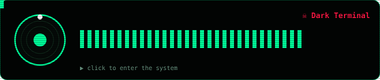

 

## 📱 Follow Me &nbsp;|&nbsp; تابعني

## 🛠️ Tech Stack

 

## 📊 GitHub Stats

  
  

## 🌐 3D Contributions

 

## 🐍 Contribution Snake

<picture>
  <source media="(prefers-color-scheme: dark)" srcset="assets/snake-dark.svg" />
  <source media="(prefers-color-scheme: light)" srcset="assets/snake.svg" />
  
</picture>

## 🎵 Music &nbsp;|&nbsp; موسيقى

 

 

⭐ If you find my work useful, support it with a star 
⭐ إذا أعجبك عملي لا تنسَ دعمه بنجمة

